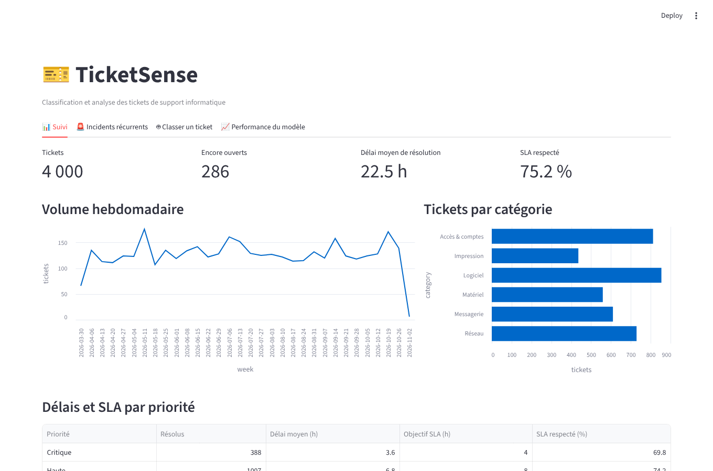
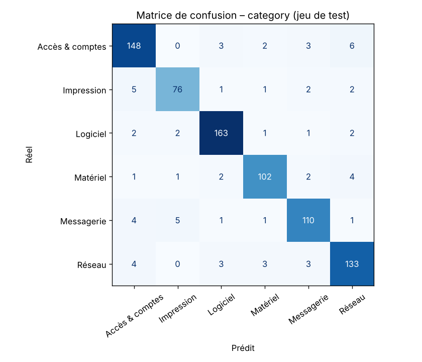
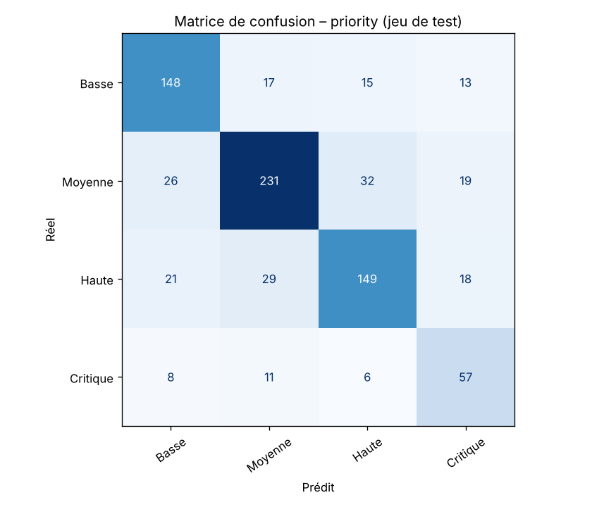
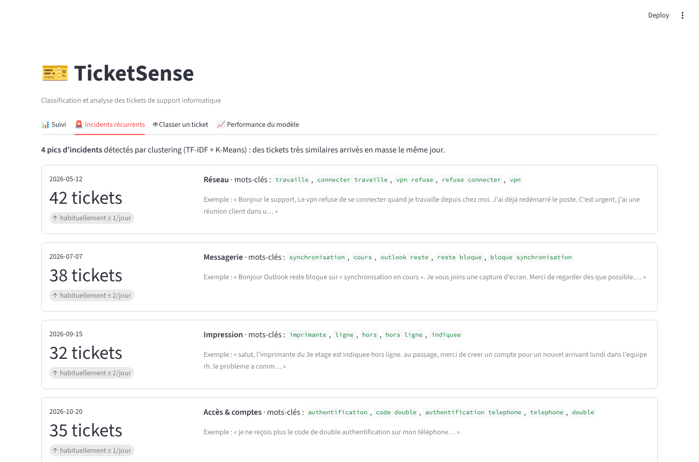

# 🎫 TicketSense – Classification et analyse de tickets de support par NLP

> Outil d'aide au support informatique : il **classe automatiquement chaque ticket** (catégorie et priorité), **détecte les incidents récurrents** (pannes qui touchent beaucoup d'utilisateurs le même jour) et suit les **délais de résolution** dans un tableau de bord.




## 🎯 Problème traité

Dans un service support, chaque ticket doit être lu, classé puis attribué à la bonne équipe avec la bonne priorité. Ce tri manuel prend du temps et varie d'un technicien à l'autre. TicketSense :

1. **propose une catégorie** parmi 6 (Réseau, Matériel, Logiciel, Accès & comptes, Messagerie, Impression) et **une priorité** (Basse, Moyenne, Haute, Critique), avec un score de confiance. Si le modèle hésite, le ticket est **signalé pour vérification humaine** ;
2. **regroupe les tickets similaires** pour repérer un incident général (ex. 40 tickets « VPN » en une matinée) ;
3. **mesure l'activité** : volumes, délais moyens, respect des SLA par priorité (requêtes SQL).

## 📊 Résultats

Évaluation sur un jeu de test de **800 tickets** (20 %, découpage stratifié, jamais vu à l'entraînement) :

| Cible | Modèle | Accuracy | Précision (macro) | Rappel (macro) | **F1 macro** |
|---|---|---|---|---|---|
| Catégorie | Référence : classe majoritaire | 0,214 | 0,036 | 0,167 | 0,059 |
| Catégorie | **TF-IDF + régression logistique** | **0,915** | 0,914 | 0,911 | **0,912** |
| Priorité | Référence : classe majoritaire | 0,385 | 0,096 | 0,250 | 0,139 |
| Priorité | **TF-IDF + régression logistique** | **0,731** | 0,700 | 0,725 | **0,709** |
| Catégorie | **DistilBERT multilingue (fine-tuning, 3 époques)** | **0,939** | 0,939 | 0,934 | **0,937** |

**Lecture des résultats**
- La **catégorie** est bien reconnue (F1 = 0,91). Les erreurs restantes viennent surtout des tickets qui évoquent deux sujets et des ~5 % d'étiquettes volontairement erronées du jeu de données : le plafond atteignable est donc autour de 0,95.
- La **priorité** est plus difficile (F1 = 0,71) : dans un tiers des tickets, l'utilisateur n'exprime aucune urgence. C'est réaliste. En production, la priorité proposée servirait de suggestion, pas de décision automatique.
- **DistilBERT** gagne **2,4 points de F1** sur la catégorie (0,937 contre 0,912) et se rapproche du plafond d'environ 0,95. En contrepartie, il demande un GPU (62 s d'entraînement sur un T4 de Google Colab, contre quelques secondes sur CPU pour TF-IDF) et une inférence plus lourde. Pour un helpdesk, TF-IDF reste un très bon choix par défaut ; DistilBERT se justifie si chaque point de précision compte.
- Le **F1 macro** est la métrique principale : il donne le même poids à chaque classe, y compris les moins fréquentes (Impression, Critique).

 

### Incidents récurrents détectés

Le clustering retrouve les **4 pannes générales** présentes dans les données, sans fausse alerte :

| Date | Tickets | Catégorie | Mots-clés du groupe |
|---|---|---|---|
| 12/05/2026 | 42 | Réseau | vpn refuse, connecter |
| 07/07/2026 | 38 | Messagerie | outlook, synchronisation |
| 15/09/2026 | 32 | Impression | imprimante, hors ligne |
| 20/10/2026 | 35 | Accès & comptes | double authentification, code |



## 🧠 Démarche

### 1. Données
Les tickets réels d'une entreprise sont confidentiels. J'ai donc écrit un **générateur reproductible** ([`data/generate_dataset.py`](data/generate_dataset.py)) de 4 000 tickets en français, conçu pour reproduire les difficultés d'un vrai helpdesk et éviter des scores artificiellement parfaits :
- vocabulaire partagé entre catégories, tickets qui mentionnent un second problème ;
- fautes de frappe, absence d'accents, abréviations (« mdp »), textes très courts ;
- objets peu informatifs (« Urgent », « Help ») ;
- priorité souvent implicite ;
- ~5 % d'erreurs d'étiquetage (comme un technicien qui classe mal un ticket) ;
- 4 vagues d'incidents cachées dans les données, pour tester la détection.

Le pipeline accepte n'importe quel CSV avec les colonnes `subject`, `body`, `category`, `priority` : il peut être réentraîné sur de vrais tickets.

### 2. Modèle de référence
`TF-IDF` sur les **mots** (1-2 grammes) **et les caractères** (3-5 grammes, robustes aux fautes de frappe) → **régression logistique** avec pondération des classes. Le modèle est simple, rapide (entraînement en quelques secondes sur CPU) et interprétable. Il est comparé à une référence naïve (prédire toujours la classe la plus fréquente) pour montrer ce qu'il apporte réellement.

### 3. Modèle Transformer
[`scripts/train_transformer.py`](scripts/train_transformer.py) fine-tune **DistilBERT multilingue** sur **exactement le même découpage** entraînement/test, pour une comparaison équitable. Entraîné sur Google Colab (GPU T4) : F1 macro de **0,937** sur la catégorie (résultats dans `reports/transformer_category.json`).

### 4. Détection des incidents
TF-IDF → réduction **SVD** (100 dimensions) → **K-Means** (30 groupes). Un incident est signalé quand un groupe reçoit en une journée au moins 15 tickets et 3 fois plus que son 90ᵉ centile journalier habituel. Le seuil sur le centile évite les fausses alertes des lundis chargés.

### 5. Indicateurs en SQL
Les tickets sont chargés dans **SQLite**. Les indicateurs (volume hebdomadaire, délais par catégorie, taux de respect du SLA par priorité) sont calculés par des requêtes SQL ([`src/ticketsense/database.py`](src/ticketsense/database.py)).

## 🛠️ Stack technique

| Domaine | Outils |
|---|---|
| NLP / Machine Learning | Python, **scikit-learn** (TF-IDF, régression logistique, SVD, K-Means), **Transformers** (DistilBERT) |
| Données | pandas, **SQL (SQLite)** |
| API | **FastAPI**, Pydantic, Uvicorn |
| Tableau de bord | **Streamlit** |
| Qualité | pytest (18 tests), ruff |
| DevOps | **Docker**, Docker Compose, **GitHub Actions** |

## 🚀 Lancer le projet

### Avec Docker

```bash
git clone https://github.com/mohammed-mrabet/ticketsense.git
cd ticketsense
docker compose up --build
```
- Tableau de bord : http://localhost:8501
- API et documentation Swagger : http://localhost:8000/docs

### En local

```bash
python -m venv .venv && source .venv/bin/activate     # Windows : .venv\Scripts\activate
pip install -r requirements.txt -r requirements-dev.txt
export PYTHONPATH=src                                  # Windows PowerShell : $env:PYTHONPATH="src"

python -m ticketsense.train        # entraîne les modèles, écrit reports/metrics.json
python -m ticketsense.clustering   # détecte les incidents récurrents
python -m ticketsense.database     # charge les tickets dans SQLite

uvicorn ticketsense.api:app --reload            # API sur http://localhost:8000
streamlit run src/ticketsense/dashboard.py      # tableau de bord
pytest                                          # tests
```

### Modèle Transformer (Google Colab, GPU)

```python
!git clone https://github.com/mohammed-mrabet/ticketsense.git
%cd ticketsense
!pip install -q -r requirements-transformer.txt
!python scripts/train_transformer.py --target category --epochs 3
```

## 📡 API

```bash
curl -X POST http://localhost:8000/predict \
  -H "Content-Type: application/json" \
  -d '{"subject": "Imprimante", "body": "L imprimante du 2e étage est hors ligne, toute l équipe est bloquée"}'
```
```json
{
  "category": "Impression",
  "category_confidence": 0.995,
  "priority": "Critique",
  "priority_confidence": 0.984,
  "needs_review": false,
  "category_scores": { "Impression": 0.995, "Logiciel": 0.002, "...": "..." },
  "priority_scores": { "Critique": 0.984, "Basse": 0.008, "...": "..." }
}
```

| Méthode | Route | Description |
|---|---|---|
| POST | `/predict` | Classe un ticket |
| POST | `/predict/batch` | Classe jusqu'à 500 tickets |
| GET | `/metrics` | Scores du modèle sur le jeu de test |
| GET | `/health` | État du service |

## 📁 Structure

```
ticketsense/
├── data/generate_dataset.py     # générateur du jeu de données (+ tickets.csv)
├── src/ticketsense/
│   ├── preprocessing.py         # nettoyage du texte
│   ├── model.py                 # pipeline TF-IDF + régression logistique
│   ├── train.py                 # entraînement et évaluation
│   ├── clustering.py            # détection des incidents récurrents
│   ├── database.py              # SQLite et indicateurs SQL
│   ├── predictor.py             # chargement des modèles et prédiction
│   ├── api.py                   # API FastAPI
│   └── dashboard.py             # tableau de bord Streamlit
├── scripts/train_transformer.py # fine-tuning DistilBERT (GPU)
├── tests/                       # tests pytest
├── reports/                     # métriques et matrices de confusion
└── Dockerfile, compose.yaml, .github/workflows/ci.yml
```

## 🔄 Intégration continue

À chaque `push`, GitHub Actions vérifie le code (ruff), **réentraîne les modèles**, **échoue si le F1 macro passe sous 0,85**, lance les tests, puis construit l'image Docker et vérifie que l'API et le tableau de bord répondent.

## 🗺️ Pistes d'amélioration

- Tester le modèle sur un jeu de tickets réels anonymisés
- Comparer avec CamemBERT et mesurer le temps d'inférence de chaque modèle
- Fine-tuner DistilBERT aussi sur la priorité
- Apprentissage continu à partir des corrections faites par les techniciens
- Routage automatique vers l'équipe concernée (intégration GLPI ou Jira Service Management)

## 👤 Auteur

**Mohammed MRABET** – Master Ingénierie Informatique, Faculté des Sciences d'Oujda
[LinkedIn](https://www.linkedin.com/in/mohammed-mrabet-b3021b410/) · [GitHub](https://github.com/mohammed-mrabet)
